# Clear Plate 光盘行动自动打卡脚本

## 导语

应学校要求，餐后要去小程序进行光盘打卡，起初想做这个脚本很久了，但是考虑到学时问题就搁置了。直到得知可以有学时，便把这个脚本做出来并持续更新。

原版教程保留在下面，方便第一次使用的同学按图抓包。新版脚本已经按 2025 和 2026 年 Issues 里的贡献者更新进行合并：接口域名已更新，支持多 Token、广告补签、多账号互赞和每天三次自动运行。

> 说明：2026 年 04 月 08 日的更新线索来自 [FairyXH](https://github.com/FairyXH) 在 Issues 中提供的新仓库和说明。本仓库没有直接覆盖成贡献者仓库，而是按原项目 `plate.py` 单脚本思路重写合并，并通过本地测试确认可以运行。

## 功能介绍

当前实现：

1. 自动提交光盘打卡。
2. 支持多个 Token，一行一个。
3. 自动提交最近 7 天广告补签。
4. 每日多个 Token 之间相互点赞。
5. 默认每天三次自动运行，也可以单次运行。
6. 日志会隐藏完整 Token，避免把敏感 Token 写进日志。

已移除旧版失效接口，当前请求地址为：

```text
https://clearplate-api.guangpanxingdong.com/index.php
```

## 许可证

本脚本使用 MIT License，详见 [LICENSE](LICENSE)。

## 准备工作

建议环境：

- Windows 系统
- Fiddler
- Python 3.8+，原教程里的 Python 3.7 也可以参考安装步骤，但新版建议 3.8 以上
- 电脑版微信最新版，可以启动微信小程序即可

安装脚本依赖：

```bash
python -m pip install -r requirements.txt
```

如果你还没有安装依赖，也可以只安装 requests：

```bash
python -m pip install requests
```

## 安装和配置

安装 Python 教程：

[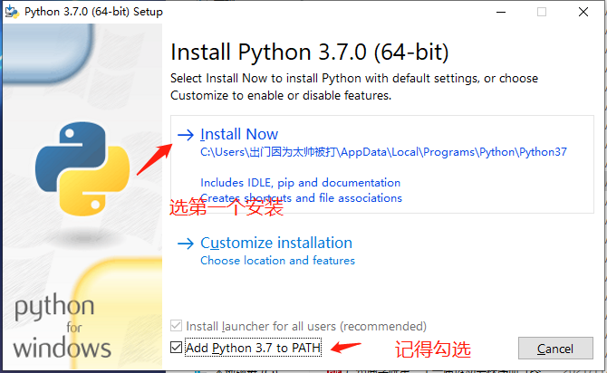](docs/images/step-1.png)

务必勾选 Add Python 3.7 to PATH 或新版安装器里的 Add python.exe to PATH。不勾选的话，需要自己配置环境变量。

[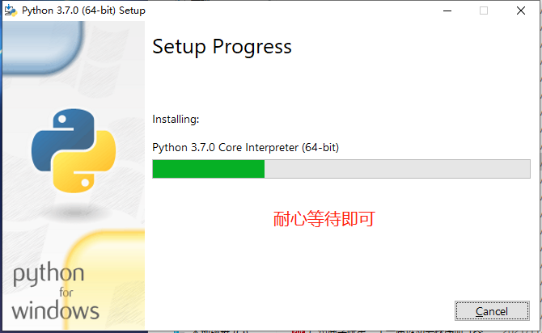](docs/images/step-2.png)

[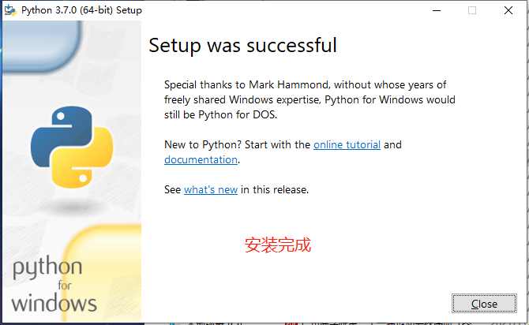](docs/images/step-3.png)

安装 requests 模块依赖：

[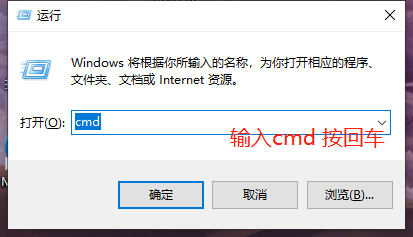](docs/images/step-4.png)

在控制台输入：

```bash
python -m pip install requests
```

[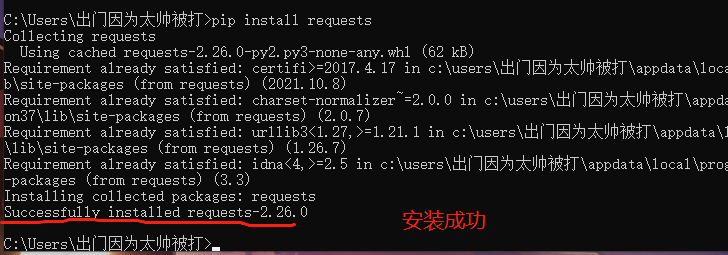](docs/images/step-5.png)

安装 Fiddler：

[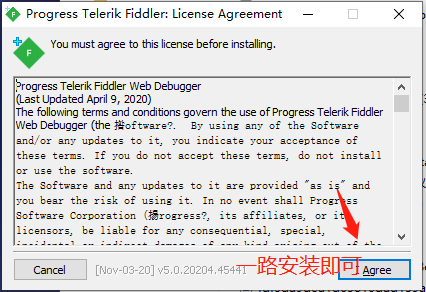](docs/images/step-6.png)

[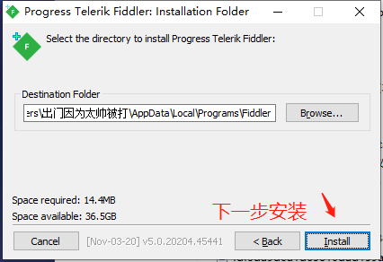](docs/images/step-7.png)

[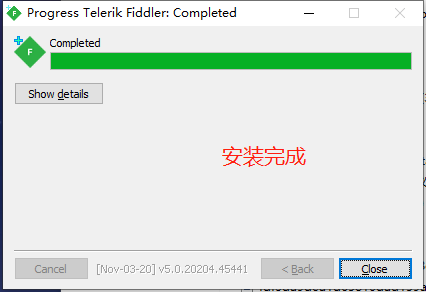](docs/images/step-8.png)

配置 Fiddler HTTPS 证书：

[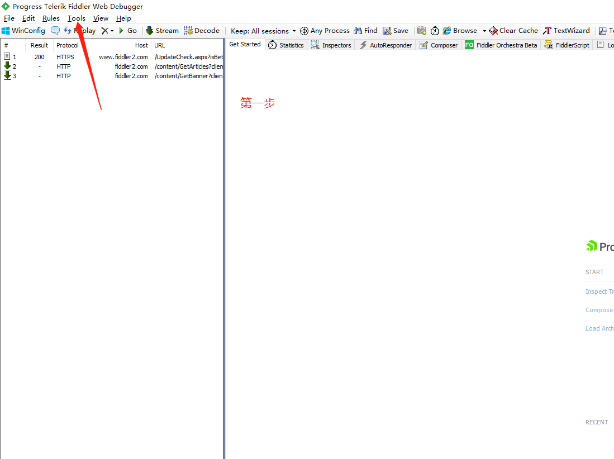](docs/images/step-9.png)

[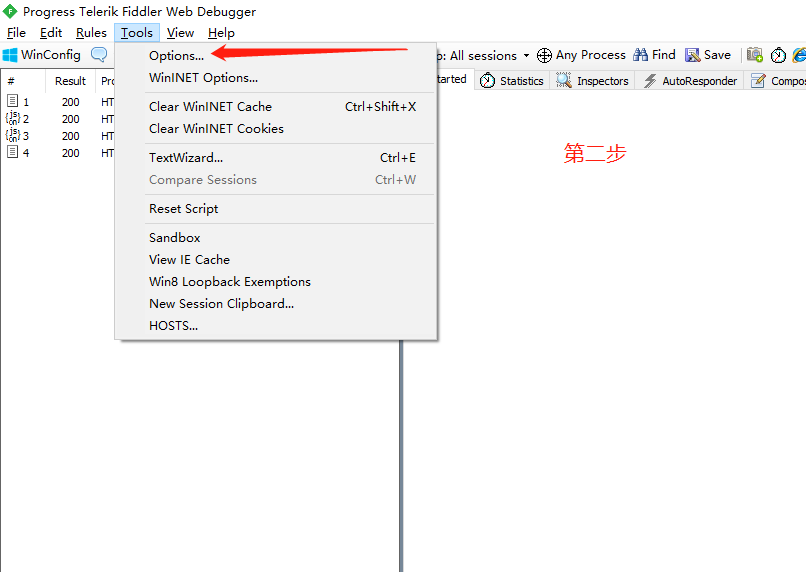](docs/images/step-10.png)

[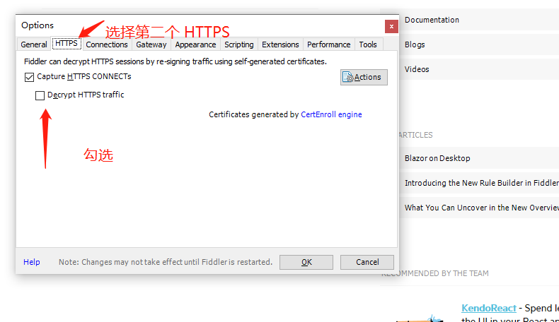](docs/images/step-11.png)

[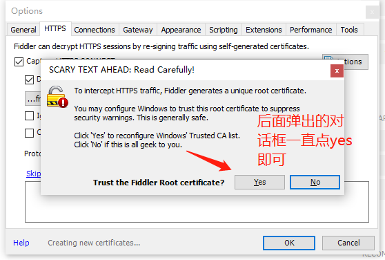](docs/images/step-12.png)

[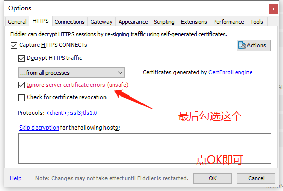](docs/images/step-13.png)

配置完成后，关闭 Fiddler 再重新打开。

## 开始抓取数据

登录电脑版微信，建议先在手机上打开一次光盘行动小程序，这样电脑版微信里更容易打开小程序。

如果遇到打不开小程序，可以退出电脑版微信后重新登录。

[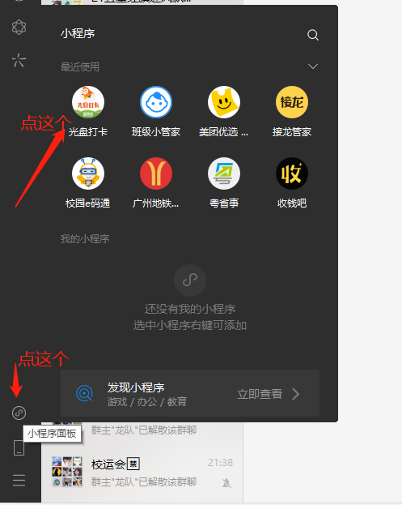](docs/images/step-14.png)

打开小程序后回到 Fiddler：

[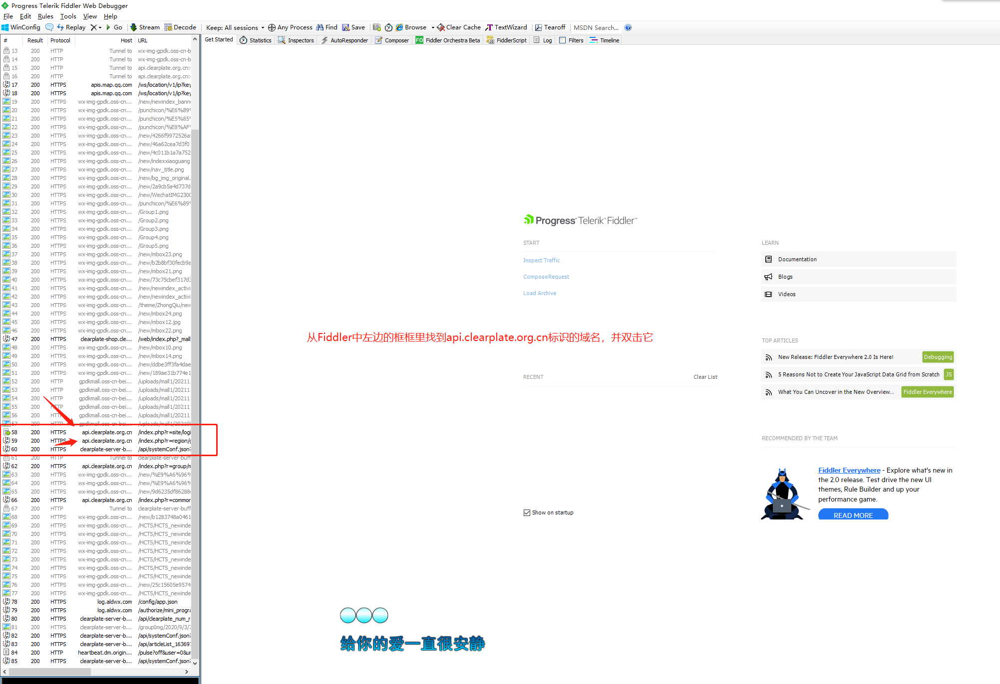](docs/images/step-15.png)

随便选一个小程序接口请求，根据图示操作：

[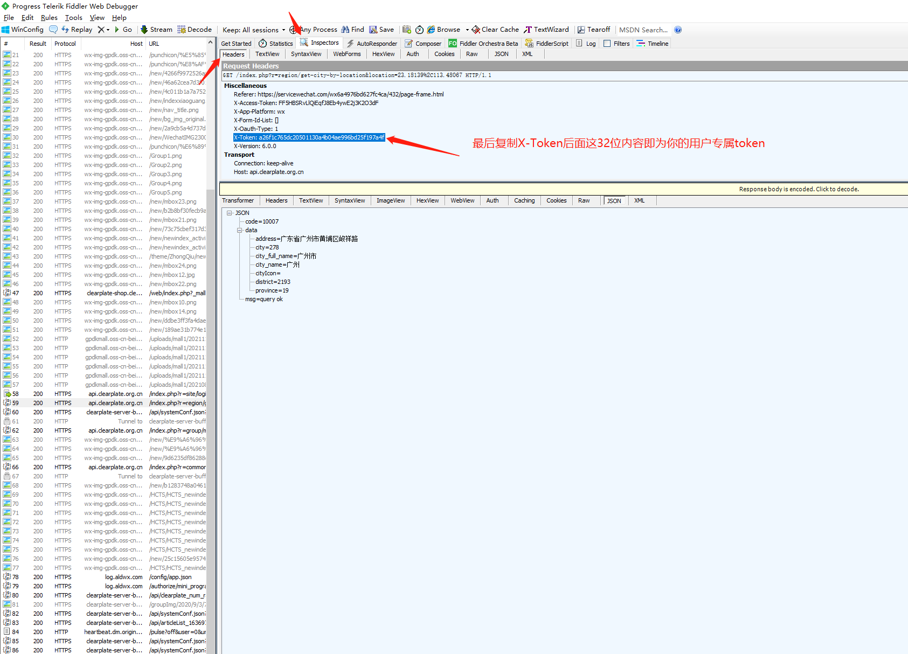](docs/images/step-16.png)

新版脚本需要你准备 4 类信息：

| 信息 | 是否必填 | 如何获取 |
| --- | --- | --- |
| `x-token` | 必填 | Fiddler 里找到请求头 `x-token`，复制整串值 |
| `group_id` | 建议填写 | 手动提交一次光盘打卡，抓包请求参数里会出现 `group_id` |
| `longitude` 经度 | 建议填写 | 用坐标拾取器搜索学校或食堂位置 |
| `latitude` 纬度 | 建议填写 | 用坐标拾取器搜索学校或食堂位置 |

## 如何查询经纬度

可以使用高德、百度、腾讯地图坐标拾取器。任选一个即可：

- 高德坐标拾取器：https://lbs.amap.com/tools/picker
- 百度地图拾取坐标系统：https://api.map.baidu.com/lbsapi/getpoint/index.html
- 腾讯位置服务坐标拾取器：https://lbs.qq.com/getPoint/

查询方法：

1. 打开坐标拾取器。
2. 搜索学校、食堂或你日常打卡的位置。
3. 点击地图上的具体点位。
4. 复制显示出来的经纬度。

注意不同网站经纬度展示顺序可能不同。脚本参数写法如下：

```bash
python plate.py --longitude 118.578482 --latitude 24.33405
```

也就是：

- `longitude` 是经度，通常是更大的那个数，例如 `118.578482`
- `latitude` 是纬度，通常是较小的那个数，例如 `24.33405`

## 如何组织这些信息

### 1. 填写 Token

首次运行脚本会自动生成 `tokens.txt`：

```bash
python plate.py
```

把抓到的 `x-token` 写入 `tokens.txt`，一行一个。多个账号就写多行，`#` 开头会被当作注释：

```text
# One x-token per line. Lines starting with # are ignored.
xxxxxxxxxxxxxxxxxxxxxxxxxxxxxxxx
yyyyyyyyyyyyyyyyyyyyyyyyyyyyyyyy
```

### 2. 填写组织 ID 和经纬度

推荐通过命令行参数传入：

```bash
python plate.py \
  --group-id 6372 \
  --longitude 118.578482 \
  --latitude 24.33405
```

Windows PowerShell 可以写成一行：

```powershell
python plate.py --group-id 6372 --longitude 118.578482 --latitude 24.33405
```

也可以通过环境变量配置，适合长期运行：

```bash
export CLEARPLATE_GROUP_ID=6372
export CLEARPLATE_LONGITUDE=118.578482
export CLEARPLATE_LATITUDE=24.33405
python plate.py
```

Windows PowerShell：

```powershell
$env:CLEARPLATE_GROUP_ID="6372"
$env:CLEARPLATE_LONGITUDE="118.578482"
$env:CLEARPLATE_LATITUDE="24.33405"
python plate.py
```

## 运行脚本

单次运行：

```bash
python plate.py --group-id 6372 --longitude 118.578482 --latitude 24.33405
```

每天三次自动运行，默认时间为 `07:01,12:01,18:01`：

```bash
python plate.py --group-id 6372 --longitude 118.578482 --latitude 24.33405 --loop
```

自定义每天运行时间：

```bash
python plate.py --run-times 07:01,12:01,18:01 --loop
```

运行起来后，终端和 `plate_log.txt` 会看到类似内容：

```text
[INFO 2026-05-21 13:34:11] Loaded user id 1001 for abcd...1234
[INFO 2026-05-21 13:34:11] Likes for abcd...1234: ['1002: liked']
[INFO 2026-05-21 13:34:11] Check-in for abcd...1234, group 6372: success
[INFO 2026-05-21 13:34:11] Supplements for abcd...1234: ['success', 'success']
[INFO 2026-05-21 13:34:11] Run finished.
```

如果 Token 不正确，接口通常会返回类似 `Access Deny`，这说明请求已经到达接口，但 Token 或账号状态不对。

## 验证脚本是否可用

旧教程里是双击运行 `plate.py`：

[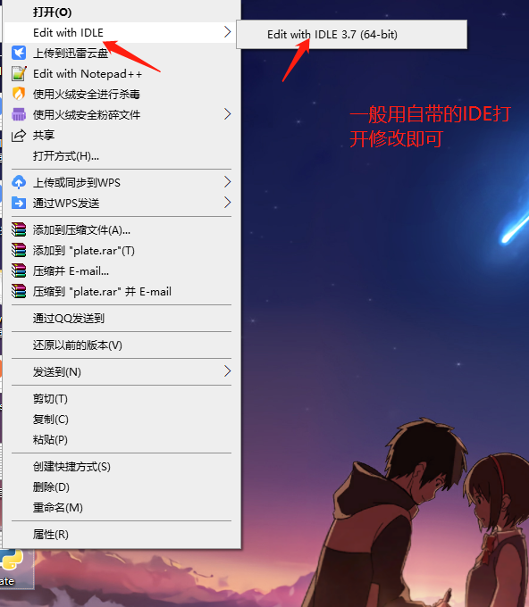](docs/images/step-17.png)

旧版做法是打开后拉到最下面改 Token：

[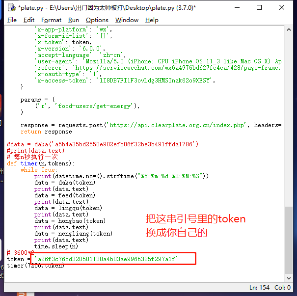](docs/images/step-18.png)

新版不再建议直接修改 `plate.py`，而是把 Token 写到 `tokens.txt`，把组织 ID 和经纬度放到命令行参数或环境变量里。这样后续更新脚本时，不容易把自己的 Token 提交到仓库。

脚本窗口最小化即可，长期运行时建议使用 `--loop`：

[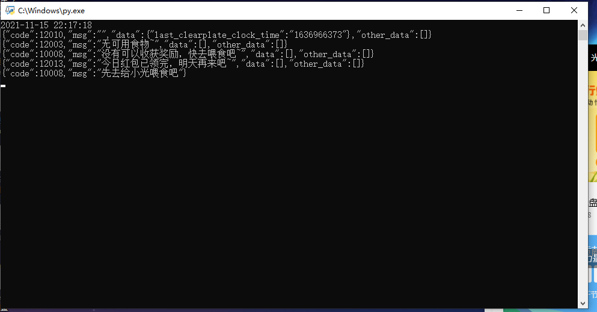](docs/images/step-19.png)

## 参数说明

| 参数 | 默认值 | 说明 |
| --- | --- | --- |
| `--token-file` | `tokens.txt` | Token 文件路径 |
| `--log-file` | `plate_log.txt` | 日志文件路径 |
| `--group-id` | `6372` | 组织 ID，建议按自己的抓包结果修改 |
| `--longitude` | `118.578482` | 经度 |
| `--latitude` | `24.33405` | 纬度 |
| `--supplement-days` | `7` | 自动补签最近多少天 |
| `--request-delay` | `1` | 请求间隔秒数 |
| `--timeout` | `15` | 单个请求超时时间 |
| `--location-jitter` | `0.001` | 经纬度随机偏移范围，设为 `0` 可关闭 |
| `--run-times` | `07:01,12:01,18:01` | `--loop` 模式下每天运行时间 |
| `--loop` | 关闭 | 开启后按 `--run-times` 每天自动运行 |

## 所需文件

推荐使用官方新版下载地址：

1. Python 下载安装：https://www.python.org/downloads/
2. Fiddler 下载：https://www.telerik.com/fiddler
3. 本仓库脚本：[plate.py](plate.py)

原教程旧链接也保留如下，如果链接失效请使用上面的官方地址：

1. python3.7 安装包：[点我下载](https://wwa.lanzoui.com/iY0Vdwjkbeb)
2. Fiddler：[点我下载](https://wwa.lanzoui.com/isCEzwjkbob)
3. 旧版 `plate.py` 下载链接已过期，请以本仓库 [plate.py](plate.py) 为准。

## 开发验证

本仓库带有离线测试，不需要真实 Token，不会访问外网：

```bash
python -m py_compile plate.py tests/test_plate.py
python -m unittest discover -s tests -v
```

真实接口是否打卡成功取决于自己的 `x-token`、组织 ID、经纬度和光盘行动接口当前策略。建议先单次运行，确认日志中的接口返回，再使用 `--loop` 长期运行。

## 本次更新验证记录

本次合并前已做以下检查：

1. 贡献者 2026 年 04 月 08 日仓库代码已审查；原样在 Python 3.11 下存在 f-string 引号语法问题，因此本仓库采用功能合并与重写方式。
2. `python -m py_compile plate.py tests/test_plate.py` 通过。
3. `python -m unittest discover -s tests -v` 通过。
4. 无 Token 首次运行会创建 `tokens.txt`，不会误发请求。
5. 使用无效测试 Token 实际请求新版 API，`/user/user-info`、`/user-clear-plate/clear-plate`、`/user-clear-plate/clear-plate-supplement`、`/user/like` 均可正常连通并返回接口 JSON。
6. 使用无效测试 Token 跑完整 `plate.py` 单次流程，脚本可正常结束并写入脱敏日志；真实成功打卡仍需要有效 Token。
